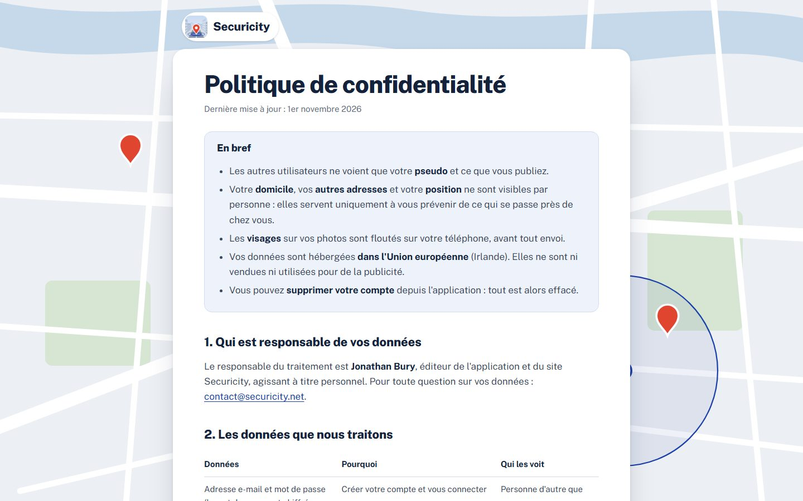

<h1 align="center">securicity.net</h1>

<p align="center">
  Site vitrine de l'application <strong>Securicity</strong> : « Votre quartier vous prévient en temps réel. »<br>
  <a href="https://securicity.net">securicity.net</a>
</p>


## Pages

| Adresse | Fichier | Contenu |
|---|---|---|
| `/` | `index.html` | Page d'accueil |
| `/confidentialite/` | `confidentialite/index.html` | Politique de confidentialité (RGPD) |
| `/conditions/` | `conditions/index.html` | Conditions d'utilisation |
| `/mentions-legales/` | `mentions-legales/index.html` | Mentions légales |
| `/confirmation/` | `confirmation/index.html` | Page ouverte après la confirmation de l'e-mail d'inscription |
| — | `email/` | Modèle de l'e-mail de confirmation |

<table>
  <tr>
    <td width="50%"></td>
    <td width="50%" valign="top">
      <strong>La page d'accueil, de haut en bas</strong>
      <ol>
        <li>Titre, alertes qui apparaissent une à une au défilement, téléphone qui montre l'app</li>
        <li>Carrousel « Tout votre quartier, dans une app »</li>
        <li>« Avez-vous vu quelque chose ? » : la discussion se remplit message par message</li>
        <li>Téléchargement</li>
        <li>Slogan et pied de page</li>
      </ol>
      
    </td>
  </tr>
</table>

## Technique

- **Pages statiques**, sans outil de construction : chaque fichier est servi tel quel.
- **Hébergement** : GitHub Pages. Le domaine est déclaré dans `CNAME`, HTTPS est imposé et `.nojekyll` désactive Jekyll.
- **Typographie** : Public Sans (Google Fonts). Icônes : [Lucide](https://lucide.dev).
- **Charte** : bleu `#1B3FA8`, rouge repère `#E0452F`, encre `#14233B`, carte `#ECEFF3`.
- **Mouvement** : toutes les animations s'arrêtent si l'appareil demande « Réduire les animations ».
- Aucun outil de mesure d'audience ni traceur.

## Modifier le site

1. Ouvrir le fichier HTML concerné et le modifier.
2. Vérifier en local :
   ```sh
   python -m http.server 8000
   ```
   puis ouvrir http://localhost:8000. Les chemins commencent par `/`, il faut donc un petit serveur : ouvrir le fichier directement ne suffit pas.
3. Pousser sur `main` : le site est en ligne environ une minute plus tard.

## Images

- `images/pillage-vitrine.jpg` : photo © Emma Da Silva/AP/SIPA, sous licence. Seule la version recadrée est publiée, l'original n'est pas versionné. Le crédit doit rester affiché sur la photo.
- `images/icone.svg`, `favicon.png`, `apple-touch-icon.png` : icône de l'app.

---

<sub>© 2026 Securicity · contact@securicity.net</sub>
